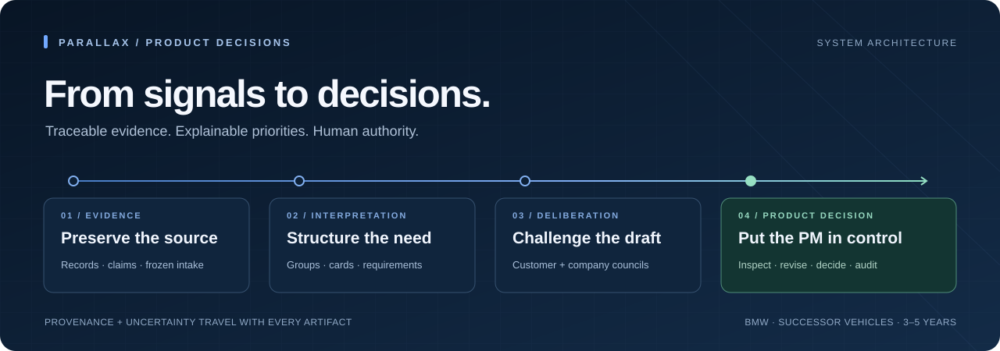
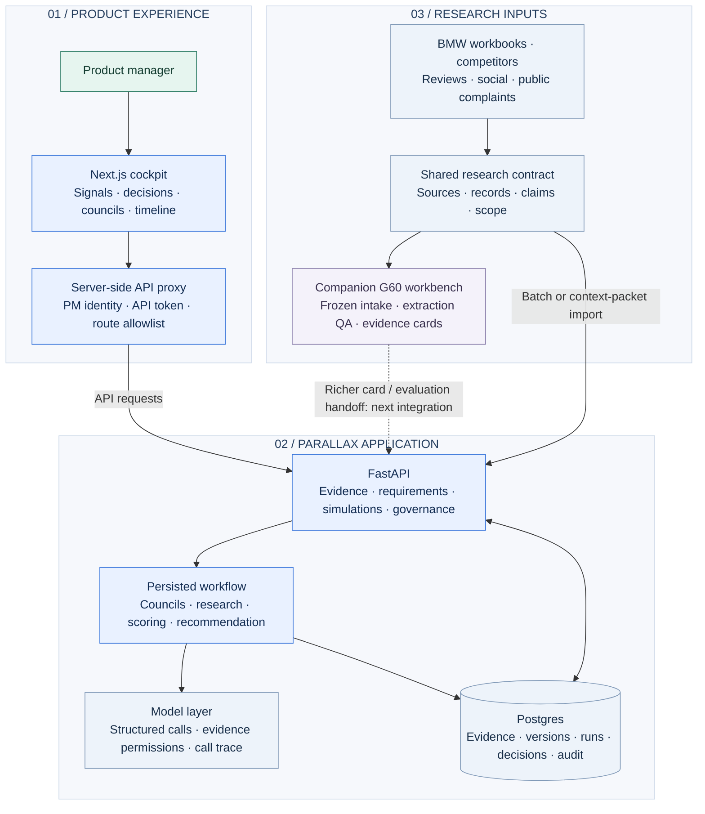
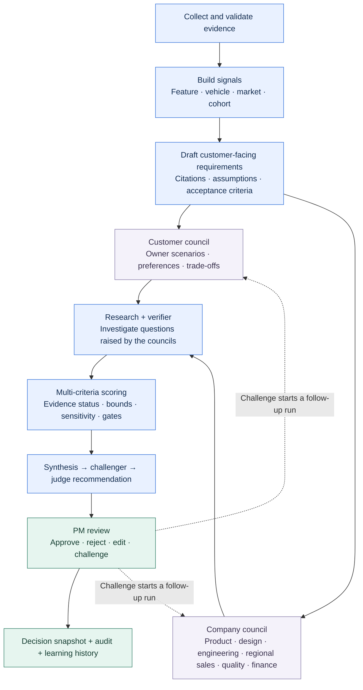
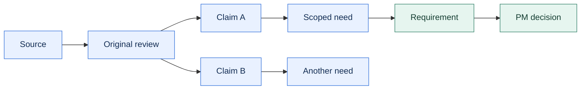
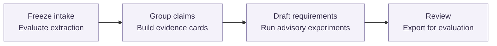

<p align="center">
  
</p>

<h1 align="center">Parallax</h1>

<p align="center">
  <strong>A product decision cockpit for the next generation of BMW vehicles.</strong><br>
  From customer evidence to actionable requirements—with competing perspectives,<br>
  explainable priorities and a product manager in control.
</p>

<p align="center">
  <a href="https://parallax.dehlwes.net/"><strong>Open Parallax ↗</strong></a> ·
  <a href="#architecture">Architecture</a> ·
  <a href="#the-decision-workflow">Decision workflow</a> ·
  <a href="#the-g60-evidence-workbench">G60 evidence workbench</a> ·
  <a href="#run-locally">Run locally</a>
</p>

---

BMW's product managers need to turn customer feedback, studies, product information and market signals into requirements for a vehicle successor **3–5 years ahead**. Parallax brings that process into one cockpit: inspect the evidence, identify needs, draft requirements, hear customer and company perspectives, challenge the recommendation, and make a traceable decision.

**Parallax is the main application on `main`.** Its Next.js cockpit and FastAPI/Postgres backend provide the product experience. The companion **G60 evidence workbench** adds a reproducible research pipeline for extraction evaluation, code-built evidence cards and tightly controlled advisory experiments. Both build on the same source → record → claim contract.

> **Implementation snapshot · 11 October 2026**<br>
> The merged application is on `main` at `469e848`, incorporating backend `5e378dd` and dashboard `edad20f`. The companion G60 US pipeline has completed an automated provisional run; its human evidence validation and PM decisions remain open. This README distinguishes the deployed application, the companion implementation and the integration still to be completed.

## Architecture

Parallax separates the PM experience, application orchestration, model execution and persisted evidence. The browser reaches the backend through a server-side proxy; the backend coordinates the workflow and records its results in Postgres.



The solid arrows show implemented application paths. The dashed arrow is the next integration boundary: Parallax already imports the shared research contract, but the companion's reviewed cards, frozen requirement revisions, evaluation reports and audit are not automatically synchronized into its database.

### Components and ownership

| Component | Responsibility | Source |
| :--- | :--- | :--- |
| **PM cockpit** | Vehicle-specific signals, decisions, councils, evidence, tasks and timelines; visual pipeline replay and individual-call inspection | [Frontend](https://github.com/eklavyagoyal/ehl-finale-munich-submission/tree/469e848/frontend) |
| **Server-side proxy** | Routes browser requests through an API allowlist and supplies the backend token and PM identity | [Proxy route](https://github.com/eklavyagoyal/ehl-finale-munich-submission/blob/469e848/frontend/src/app/bff/%5B...path%5D/route.ts) |
| **Application API** | Evidence intake, requirement lifecycle, simulation runs, agents, policies and human actions | [API contract](https://github.com/eklavyagoyal/ehl-finale-munich-submission/blob/469e848/backend/API.md) |
| **Workflow engine** | Runs the councils, research/verifier loop, scoring, synthesis, challenger and judge recommendation; persists stage outcomes | [Orchestrator](https://github.com/eklavyagoyal/ehl-finale-munich-submission/blob/469e848/backend/parallax/orchestrator.py) |
| **Decision model** | Combines criterion ratings, preserves uncertainty, computes bounds and checks rank sensitivity | [Scoring](https://github.com/eklavyagoyal/ehl-finale-munich-submission/blob/469e848/backend/parallax/scoring.py) · [Shared policy](research/decision-model.json) |
| **Product state** | Sources, records, claims, requirements, versions, model calls, recommendations, PM decisions and audit events | [Database models](https://github.com/eklavyagoyal/ehl-finale-munich-submission/blob/469e848/backend/parallax/models.py) |
| **Research contract** | Stable identities, collection provenance, model/market scope and evidence-to-claim links | [Collection guide](research/README.md) · [Contract design](docs/research-data-contract.md) |
| **G60 companion** | Frozen intake, human-label evaluation, bounded extraction/grouping, deterministic cards and reproducible exports | [Pipeline runbook](research/g60/README.md) |

**Application stack:** Next.js, React and TypeScript in the cockpit; FastAPI, SQLAlchemy and Alembic in the backend; Postgres for persisted state. The workflow uses bounded thread pools and stored stages. Persona execution supports direct structured calls or TinyTroupe; mock mode supports local development without model API calls.

## The decision workflow

A requirement moves through a sequence of evidence, deliberation and human judgment. The customer council and company council review it from different perspectives before the system produces a recommendation.



| Step | What the application does | What the PM can inspect |
| :--- | :--- | :--- |
| **1 · Understand** | Ingests research, triages reviews, labels topics and builds scoped signals | Original records, source status, cohort counts and signal weights |
| **2 · Formulate** | Drafts actionable customer requirements with linked findings and future assumptions | Customer problem, proposed behavior, evidence and uncertainty |
| **3 · Deliberate** | Runs market-scoped owner scenarios and relevant company departments | Positions, counterarguments, constrained customer trade-offs and open questions |
| **4 · Investigate** | Sends information requests through a research and verification loop | Findings and their verification outcome |
| **5 · Prioritize** | Computes the decision model, synthesizes the case and presents the strongest counter-case to the judge stage | Criterion ratings, score bounds, sensitivity, gates and recommendation drivers |
| **6 · Decide** | Records the PM action and captures the decision context | Rationale, history, dissent and the basis for a later challenge |

The cockpit exposes the process itself: vehicle-specific pages, pipeline replay, weighting panels and call details. A call can show the stored prompt, answer, summary, model metadata and citations. Where an older answer was not retained, the interface says so.

## Evidence and prioritization

### A review keeps its identity



One review may contain several claims. For a given need, repeated claims from that review count once in the distinct-review measure. The same review can support different needs, so counts across needs are not additive. These counts describe the collected evidence, not unique people or population prevalence. Vehicle, market and cohort boundaries remain part of the interpretation; competitor evidence supplies competitive context, and brand-wide app feedback is distinct from model-specific demand.

### A score carries its basis

The shared policy uses six criteria: **demand, impact, competitive gap, vehicle/market fit, delivery fit and reuse**. Parallax distinguishes observed, estimated, simulated, assumed and unknown inputs. Simulated and assumed ratings contribute labelled ranges. Unknown criteria retain their possible contribution rather than disappearing through weight redistribution.

The displayed midpoint summarizes the lower–upper bounds; it is not a measured point estimate. Weight sensitivity and overlapping intervals help the PM see when the ordering is uncertain. Gates constrain recommendations and approvals, and the final decision belongs to the PM.

Each requirement presents the eight BMW deliverables: **ID, description, linked findings/sources, priority, rationale, evidence level, future assumptions/uncertainties and status.** Proposed targets and future assumptions must remain distinguishable from observations about today's customers.

## The G60 evidence workbench

The companion pipeline develops the evidence-quality side of the same product idea. Its first execution slice is **G60 in the United States**. It can prepare and evaluate research independently, making the evidence behind a requirement easier to reproduce and challenge.



| Capability | Contribution to the combined approach |
| :--- | :--- |
| **Frozen, verifiable intake** | Re-run an experiment against the same source bytes and stable IDs |
| **Extraction evaluation** | Export/import human labels, compare atomic claims and retain explicit failures and zero-claim outcomes |
| **Inspectable grouping** | Propose subgroups within feature families and stances, then review and merge memberships |
| **Deterministic cards** | Compute counts and coverage in code, preserve exact quote links and include contrary evidence |
| **Controlled advisory experiments** | Freeze requirement/card references, run four internal roles and four scenario personas, and validate hypothetical responses |
| **Revision and audit discipline** | Keep immutable artifacts and an append-only hash-chained log; reject stale writes and reset local approval/scoring after content edits |
| **Evaluation exports** | Produce shortlists, family/stance frequency, local rankings, context inventory and blinded baseline-versus-refined packets |

The workbench uses Python and JSON/JSONL artifacts, with SQLite for its model-spend ledger. Its local PM interface is a companion review surface. **Parallax remains the main product cockpit.**

### How the two implementations meet

**Implemented today:** a common research contract and Parallax's batch/context-packet importer. The G60 workbench also contains a stateless advisory adapter derived from Parallax's earlier company/market prompts, running through the workbench's own permissions, spend controls and audit.

**Next integration:** carry reviewed card references, extraction coverage and evaluation metadata into Parallax through an explicit import/API contract, preserving their IDs, hashes and review status. Parallax should own product decisions in that joined workflow; the companion should preserve the research provenance and evaluation artifacts behind them. Rich-card synchronization and a unified cross-system decision history are not implemented yet.

The two scoring paths also remain distinct: Parallax can incorporate labelled simulated/assumed ranges, while the companion excludes jury opinion from its evidence score. Their outputs should retain those semantics when presented together. See the [integration record](research/g60/PARALLAX_INTEGRATION_STATUS.md) for current versions and the exact handoff boundary.

## Run locally

### Main application

Use a checkout of **`main`**, Python 3.11, Node.js 22 and Postgres 16. The backend scripts support a project-local Postgres cluster; set `PG_BIN` if its binaries are outside the default path. See the [backend setup](https://github.com/eklavyagoyal/ehl-finale-munich-submission/blob/469e848/backend/README.md) for platform and live-model configuration.

```sh
# From the repository root on main.
cd backend
python3.11 -m venv .venv
.venv/bin/pip install -r requirements.txt
cp .env.example .env
scripts/db.sh init

# Rebuild the dedicated parallax_demo database with synthetic fixtures.
# This replaces any existing content in that demo database.
scripts/demo_db.sh
scripts/demo_db.sh serve
```

The demo serves the API on **http://127.0.0.1:8001** and uses mock models. In another terminal:

```sh
cd frontend
cp .env.example .env.local
npm ci
npm run dev
```

Open **http://localhost:3000**. The frontend example already targets the demo API. Backend credentials belong in server-side configuration; the browser calls `/bff`, and the API token stays in the proxy. For remote use, configure the application's authentication and backend token settings described in the [frontend guide](https://github.com/eklavyagoyal/ehl-finale-munich-submission/blob/469e848/frontend/README.md).

### Companion workbench

In the checkout containing `scripts/g60_pipeline.py`, run the [invented end-to-end demo](research/g60/README.md#run-the-invented-demo). It needs Python and `uv`, makes no model API calls, and writes to a fresh ignored workspace. The [runbook](research/g60/README.md) covers real inputs, human labels, source review, live-model permissions, budget limits and resumable execution.

## Verification and maturity

The backend included in this `main` snapshot passed **nine pure unit tests** against an isolated copy of the same backend tree now on `main`. The deployed overview was checked separately. This check did not rerun the latest frontend build, database integration tests or live-model workflow. The companion's invented demo and intake verification passed with zero model API calls and zero human approvals.

The repository provides separate checks for each layer:

| Layer | Check |
| :--- | :--- |
| Shared research contract | `uv run --with 'jsonschema[format]==4.26.0' python scripts/validate_research.py research/examples` |
| Parallax pure logic, from `backend/` | `.venv/bin/python -m pytest tests/test_units.py -q` |
| Parallax API/database flow, from `backend/` | `.venv/bin/python -m pytest` — uses the dedicated synthetic test database; requires Postgres |
| Cockpit, from `frontend/` | `npm run lint`, `npm run check:allowlist`, `npm run build` |
| Companion implementation | `uv run --with 'jsonschema[format]==4.26.0' python -m unittest discover -s tests -t . -v` in the G60 implementation checkout |

Engineering checks establish behavior and integration. Human-labelled extraction evaluation, reviewed evidence and persona grounding establish what the research can support. The completed provisional G60 run does not establish customer demand, validate a market simulation or substitute for a PM decision.

## Repository guide

```text
main
├── frontend/                 Parallax cockpit and server-side API proxy
├── backend/                  FastAPI, workflow, agents, persistence and migrations
├── research/                 Shared contract, catalogs, policy and collection handoffs
├── scripts/                  BMW export and research validation/context tools
├── scrapers/                 Social and app-review collection
├── competitors/              Competitor research workstream
├── notebooks/                Source-data exploration
└── docs/                     BMW challenge, datasets and PM interview

G60 companion implementation
├── scripts/g60_*.py          Evidence pipeline, advisory adapter and local review app
├── research/g60/             Schemas, runbook, evaluation rubric and alignment checks
├── tests/test_g60_*.py       Companion regression coverage
└── outputs/research/         Generated artifacts, audit and local operations [ignored]
```

| Start here if you want to… | Guide |
| :--- | :--- |
| Use the product | [Open Parallax](https://parallax.dehlwes.net/) |
| Understand BMW's challenge | [Challenge and source guide](docs/README.md) · [Consolidated brief](docs/challenge/brief.md) |
| Develop the application | [Backend](https://github.com/eklavyagoyal/ehl-finale-munich-submission/blob/469e848/backend/README.md) · [Frontend](https://github.com/eklavyagoyal/ehl-finale-munich-submission/blob/469e848/frontend/README.md) · [API](https://github.com/eklavyagoyal/ehl-finale-munich-submission/blob/469e848/backend/API.md) |
| Collect compatible evidence | [Research contract](research/README.md) · [BMW agent](research/prompts/agent-bmw.md) · [Competitor agent](research/prompts/agent-competitors.md) · [Social agent](research/prompts/agent-social.md) |
| Evaluate the G60 slice | [Workbench runbook](research/g60/README.md) · [Annotation rubric](research/g60/annotation-rubric.md) · [BMW alignment](research/g60/BMW_ALIGNMENT.md) |
| Understand the combined architecture | [Parallax × G60 integration record](research/g60/PARALLAX_INTEGRATION_STATUS.md) |

Raw source files, generated workspaces, credentials and local operations artifacts belong in ignored storage. Share code, schemas, invented fixtures and safe documentation through Git.
