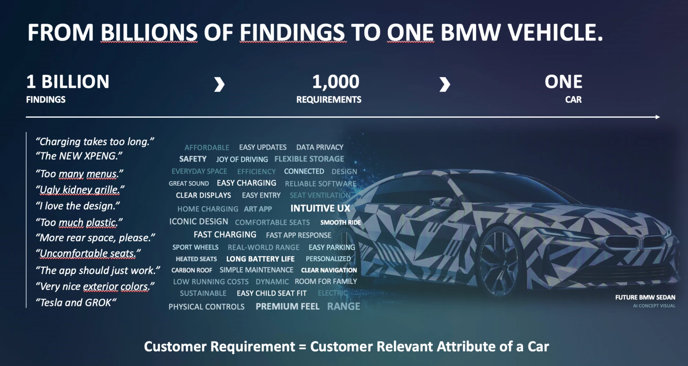
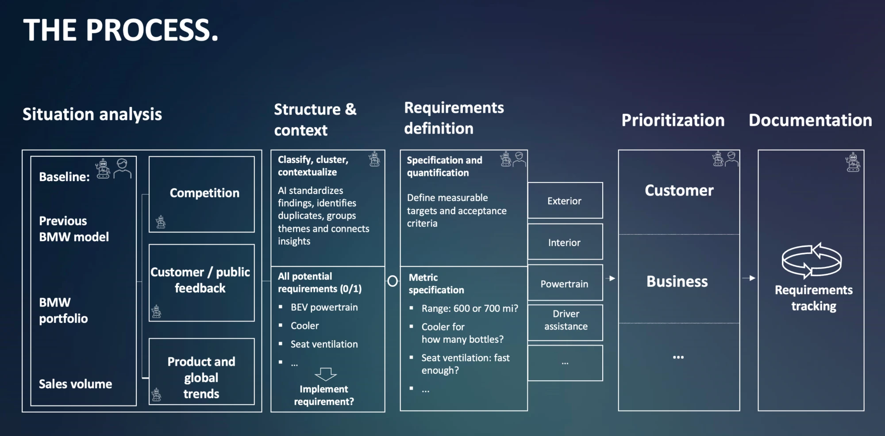

# BMW Challenge — AI for Product Decision Making

Everything BMW gave us about the challenge, consolidated in one place (EHL Munich 2026 final, TUM.ai, 10–11 Oct 2026).

**Sources** (originals in [`sources/`](sources/)):

| # | Source | What it is |
| --- | --- | --- |
| S1 | [`BMW_Hackathon_Briefing_Short.pdf`](sources/BMW_Hackathon_Briefing_Short.pdf) | Official 2-page briefing (BMW Group) |
| S2 | Detailed mission text (shared by BMW, pasted by the team) | Sections 1–5: mission, scope, "make it yours", deliverables |
| S3 | [`slide-data-and-sources.png`](sources/slide-data-and-sources.png) | Table "Data and sources — provided data (per vehicle)" |
| S4 | [`slide-billions-of-findings-to-one-vehicle.webp`](sources/slide-billions-of-findings-to-one-vehicle.webp) | Slide "From billions of findings to one BMW vehicle" |
| S5 | [`slide-the-process.webp`](sources/slide-the-process.webp) | Slide "The process" (BMW's requirements workflow) |

Where S1 and S2 differ in wording or emphasis, both are kept and marked.

---

## 1. The challenge in one paragraph

*What should the next generation of a BMW vehicle offer its customers?* Build an AI-powered application that helps product managers (PMs) **derive, justify and prioritize customer requirements for a successor vehicle**. Ground the proposals in customer feedback, BMW product and sales data, and relevant web research, while keeping **the PM firmly in control of every decision**. (S1)

## 2. Why this matters (S1)

- Defining a new vehicle generation means understanding what customers value today **and** anticipating what they will value when the successor reaches the market.
- PMs turn large volumes of customer feedback, market signals, competitor information and product data into well-founded product requirements.
- Today this work is largely **manual, time-consuming and hard to trace consistently**.
- AI could help PMs identify relevant insights, formulate requirements and justify prioritization decisions more efficiently, while keeping **evidence, assumptions and uncertainties transparent and under human control**.

## 3. Mission

### 3.1 Short version (S1)

Develop an application that helps PMs **define, explain and prioritize customer-facing requirements for the successor of an existing BMW vehicle line**.

- **Vehicles:** BMW 1 Series, 5 Series, 7 Series, or a combination.
- **Markets:** Europe, China, the United States, or any subset that best demonstrates the approach.
- **Time horizon:** think **3–5 years ahead**. Which customer needs and expectations should shape the next generation?
- Make clear **where conclusions rest on available evidence and where they rely on forward-looking assumptions**.
- For each vehicle BMW provides **customer feedback, equipment data, sales volumes and a customer study**. Teams may enrich these with external sources (competitor information, reviews, market or technology trends).
- BMW cares about **how the solution turns diverse information into actionable PM insights and makes its reasoning transparent**, not about a specific workflow or technical architecture.

### 3.2 Detailed version (S2, section 1 "Your mission")

Build an AI-powered application that ingests heterogeneous data, derives customer requirements for a vehicle, prioritizes them, and puts a PM in the loop at the decisions that matter. The app should be able to:

1. **Ingest** the provided data and enrich it with structured knowledge from the web.
2. **Extract signals** such as recurring complaints, unmet needs, competitor advantages and market trends, **each linked to its sources**.
3. **Derive requirements** from those findings: clear, actionable, customer-facing and realistic.
4. **Prioritize** them with a logic we define and can explain.
5. **Involve the PM** to approve, reject, edit or challenge requirements, along with the rationale and evidence behind them.
6. **Record everything in an audit trail**: a complete, chronological record of all actions, changes and access events within the system.

## 4. Scope (S2, section 2)

| In scope: customer requirements on the product | Out of scope |
| --- | --- |
| Features and equipment | Regulatory and homologation requirements (e.g. safety, emissions, type approval) |
| Comfort and space | Technical and engineering requirements (e.g. component specs, architecture, supplier topics) |
| Usability | Pricing, business case and cost calculation. **Cost or effort may be used as a rough prioritization factor.** |
| Infotainment and digital services | |
| Design and quality perception | |
| Driving experience | |
| Range and charging **as experienced by the customer** | |
| Variant and package offering, etc. | |

S1 says the same in short form: focus on **customer value** rather than engineering specifications, regulatory requirements or detailed business-case calculations.

## 5. Make it yours

- Demonstrate the application for **at least one derivative in one market**. Don't design it as a one-off: it should be **adaptable to other BMW vehicles and markets**. The remaining datasets and scenarios are available for optional testing. (S2)
- The challenge is broad on purpose. Focus where the team can contribute most, for example (S1 + S2):
  - going deep on **web research** and turning external information into usable evidence,
  - integrating and interpreting the **provided BMW data**,
  - uncovering customer insights, formulating compelling requirements, improving prioritization,
  - designing an effective **human-in-the-loop** experience.
- Not every capability needs the same maturity, but **show how the chosen focus connects to the full path from evidence to PM decision**. (S2)
- Consider how the concept scales across vehicle lines, markets and future product decisions. (S1)
- **What BMW values (S1):** trustworthy sources, transparent reasoning, thoughtful prioritization, and a clear understanding of **uncertainty and conflicting evidence**.

## 6. Deliverables

### 6.1 What to demonstrate (S1)

- **A concept and working prototype** showing how AI supports the identification, formulation and prioritization of customer-facing requirements, using the provided data and, where relevant, external sources.
- **A representative set of requirements supported by clear evidence and reasoning.** Show how customer feedback, product data, market signals or competitor insights translate into requirements, and explain the factors driving their prioritization.
- **A transparent decision-support experience** that lets PMs review, challenge, modify, approve or reject AI proposals, with evidence, assumptions, uncertainties and key decisions visible and traceable throughout.

### 6.2 Expected deliverables (S2, section 5)

> S2 jumps from section 3 to section 5; its section 4 is empty in the source.

1. **Concept and demonstrable prototype** of an AI-powered product-requirements application that processes heterogeneous inputs, derives product requirements, supports prioritization and integrates human review.
2. **Structured sample list of derived product requirements.** Every requirement needs all of these fields:
   - [ ] Unique identifier
   - [ ] Clear, actionable description
   - [ ] Linked findings and sources
   - [ ] Priority or score
   - [ ] Applied prioritization rationale
   - [ ] Evidence level
   - [ ] Key future-facing assumptions and uncertainties
   - [ ] Current decision status
3. **Clearly defined end-to-end workflow** showing how inputs become proposed and prioritized requirements, **which activities the AI performs autonomously, and where human review is mandatory**.
4. **Demonstrable audit trail** that makes each requirement traceable from its findings and sources through consolidation, scoring, prioritization and human decision-making. It must record changes to requirement **content, scores, priorities, evidence and status**, including **who or what** initiated each change, **when**, and the **documented rationale**.

> Teams choose their own technical approach, architecture, prioritization logic and UX. The deliverables describe capabilities and outcomes, not a prescribed design. They can be one integrated solution or a set of connected concepts, prototypes, models and visualizations. (S2)

## 7. Provided data (S3)

"Provided data (per vehicle)":

| Dataset | What it contains | What it is good for | Our file(s) |
| --- | --- | --- | --- |
| **Customer verbatims** | Free-text customer feedback on the current vehicle | Pain points, unmet needs, what customers love and must not lose | `*_feedback_hackathon.xlsx` |
| **Equipment list** | Standard and optional equipment by trim and market | What the car offers today, gaps against competitors | `*_OptionList.PDF` |
| **Sales volumes** | Units by powertrain and region | Where the car sells, which powertrains matter, where it underperforms | `sales_volumes.xlsx` |
| **Customer study** | Customer ratings in various categories | How customers perceive, like/dislike and rate different components of a car | `F70_G60_G68_G70_customer_studies.xlsx` |

Schemas, value distributions and quirks of each file: [`../datasets/`](../datasets/README.md).

## 8. BMW's framing: from findings to one car (S4)

**1 billion findings › 1,000 requirements › one car.**

> **Customer requirement = customer-relevant attribute of a car.**

- **Example findings (raw customer voice):** "Charging takes too long." · "The NEW XPENG." · "Too many menus." · "Ugly kidney grille." · "I love the design." · "Too much plastic." · "More rear space, please." · "Uncomfortable seats." · "The app should just work." · "Very nice exterior colors." · "Tesla and GROK"
- **Example requirement themes (word cloud):** affordable, easy updates, data privacy, safety, joy of driving, flexible storage, everyday space, efficiency, connected, design, great sound, easy charging, reliable software, clear displays, easy entry, seat ventilation, home charging, art app, **intuitive UX**, iconic design, comfortable seats, smooth ride, fast charging, fast app response, sport wheels, real-world range, easy parking, heated seats, long battery life, personalized, carbon roof, simple maintenance, clear navigation, low running costs, dynamic, room for family, sustainable, easy child seat fit, electric, physical controls, **premium feel**, **range**
- Visual: "Future BMW sedan" (AI concept visual).

Takeaway: the job is **condensing many noisy, overlapping findings into a manageable set of customer-relevant attributes**. The findings mix complaints, praise, competitor mentions (XPENG, Tesla, Grok) and trends.

## 9. BMW's requirements process (S5)

Five stages, left to right. The slide marks each box with a **robot icon (AI)** and/or a **person icon (human)**:

| Stage | Box | Content on the slide | AI | Human |
| --- | --- | --- | :---: | :---: |
| **1. Situation analysis** | Baseline | Previous BMW model · BMW portfolio · Sales volume | ✓ | ✓ |
| | Competition | | ✓ | |
| | Customer / public feedback | | ✓ | |
| | Product and global trends | | ✓ | |
| **2. Structure & context** | Classify, cluster, contextualize | "AI standardizes findings, identifies duplicates, groups themes and connects insights" | ✓ | |
| | All potential requirements (0/1) | e.g. BEV powertrain, cooler, seat ventilation, … → **"Implement requirement?"** (binary yes/no) | | |
| **3. Requirements definition** | Specification and quantification | "Define measurable targets and acceptance criteria" | ✓ | ✓ |
| | Metric specification | e.g. *Range: 600 or 700 mi?* · *Cooler: for how many bottles?* · *Seat ventilation: fast enough?* | | |
| | (unlabeled column, likely domains) | Exterior · Interior · Powertrain · Driver assistance · … | | |
| **4. Prioritization** | | Customer · Business · … | ✓ | ✓ |
| **5. Documentation** | Requirements tracking | (cycle icon: continuous tracking) | ✓ | |

Reading of the slide (our interpretation):

- **AI-only (autonomous) steps:** gathering competition, feedback and trends; classifying, clustering and de-duplicating findings; documentation and requirements tracking.
- **AI + human (review mandatory) steps:** setting the baseline, specifying and quantifying requirements, prioritization. These map directly onto deliverable 6.2 #3 ("where human review is mandatory").
- Requirements go through two levels: first a **binary decision** (implement: 0/1), then a **metric specification** (how much / how good).
- Prioritization weighs **customer** value against **business** factors.

## 10. Related inputs from BMW people

- Notes from the conversation with a BMW product manager: [`../bmw-pm-interview/`](../bmw-pm-interview/). It covers the signal channels, the prioritization questions BMW actually asks, the 1–2 year iteration loop, and how lines between vehicle classes are drawn.

## 11. Quick facts

| | |
| --- | --- |
| Vehicles (e-codes) | **F70** = 1 Series · **G60** = 5 Series sedan · **G68** = 5 Series long wheelbase (China; customer study only) · **G70** = 7 Series |
| Markets in focus | Europe, China, USA (any subset) |
| Horizon | Successor vehicle, 3–5 years ahead |
| Minimum demo | ≥ 1 derivative in ≥ 1 market, built to generalize |
| Hard constraints | Customer-facing requirements only; no regulatory, engineering or pricing work |
| Must-haves | Requirement list (8 fields), E2E workflow with AI-vs-human split, audit trail, PM-in-the-loop prototype |
