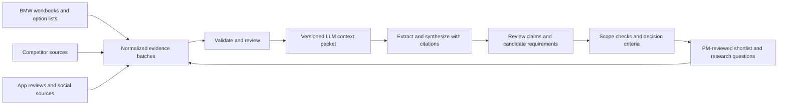

# Research data contract and orchestration

Version: 1.0. Created: 2026-10-10. Status: team handoff contract, ready for a pilot batch.

The goal is an evidence-backed customer-requirement shortlist for successor vehicles to F70, G60, and G70, separated by market. The BMW challenge brief sets a 3–5 year horizon and requires PM control, transparent assumptions, and an audit trail. Demonstrate at least one derivative in one market while retaining support for the others. The collection contract also supports exploratory dashboards.

Read [the challenge brief](challenge/brief.md) and [the BMW product-manager discussion](bmw-pm-interview/bmw-product-manager-groundwork.md) before selecting the demo. Detailed pricing/business-case calculations, regulatory requirements, and engineering specifications are outside challenge scope. Rough effort can inform prioritization; it is not a required engineering study. Keep current evidence and future-facing assumptions distinct.

## What we are building

Use Git as the shared handoff and version history. Use JSON Lines for repeated observations and feature claims; ordinary JSON for manifests, catalogs, and decision settings. JSON Lines uses UTF-8 and one valid JSON value per line ([format specification](https://jsonlines.org/)). Our contract requires objects, without blank lines, duplicate object keys, NaN, or Infinity.

| Layer | Meaning | Example |
| --- | --- | --- |
| Evidence | What a source actually contains | Original review, study statistic, explicit competitor specification |
| Claims | A human or model's interpretation | This review requests scheduled cabin heating |
| Decisions | Proposed action under stated criteria | Investigate scheduled heating for F70 in DE |



An LLM can read the first full packet and help discover themes. Retain original observations so themes can be checked and reinterpreted. Merge, count, and deduplicate with deterministic code or a reviewed export.

## Repository layout and ownership

```text
data/                                   existing local originals; ignored
research/
  README.md                             teammate quick start
  schema.json                           sources, records, claims
  catalog/entities.json                 canonical subjects and target models
  catalog/features.json                 proposed vocabulary, not findings
  decision-model.json                   proposed weighting policy
  examples/<example-batch>/             synthetic templates; never real evidence
  batches/
    bmw/<collector>-<date>-<topic>/
    competitors/<collector>-<date>-<topic>/
    social/<collector>-<date>-<topic>/
      source.json
      records.jsonl
      claims.jsonl                      optional
  prompts/synthesize.md
scripts/validate_research.py
scripts/build_research_context.py
outputs/research/<run-id>/               generated context and analysis; ignored
```

Each collector owns their batch directories. The orchestrator owns catalog review and merges. Collectors may append needed entity/feature entries for validation and list additions in their handoff; preserve existing IDs and entries. Separate batches by source artifact or coherent collection job: channel, query, date window, and app/model scope. Do not have everyone append to one giant file. Use the team's existing branch/PR workflow; do not force-push shared work.

Keep source originals unchanged and record their relative path and SHA-256 when available. Originals are already excluded from Git by this repository. Commit contracts, permitted normalized exports, and small reviewable results. If BMW content cannot be committed, retain it locally or in existing authorized shared storage and commit a manifest/reference. `export_permissions.git` and `.external_llm` are separate: true means confirmed for that destination, false means disallowed, null means unresolved. Metadata does not enforce authorization; review and exporters must respect it. Git access does not establish permission for an external model upload.

The package contains the contract, validator, offline context exporter, synthetic templates, agent prompts, and an [integration checklist](../research/INTEGRATION.md). Real source ingestion, reviewed competitor-match integration, model inference, and the PM decision/audit workflow are the next implementation steps.

## Minimum collection handoff

Every batch contains `source.json` and nonempty `records.jsonl`. `claims.jsonl` is optional, so collection is not blocked on extraction.

The source manifest captures origin, location, collector, collection time, dataset identity, normalized record count, query, date window, retrieved count, completeness, sampling limitations, provenance checks, original artifact, permissions, and review status. An API error, partial scrape, or inaccessible page goes in `sampling.limitations`, with `complete = false`. A failed or zero-result collection belongs in a collection note, not a fake observation or successful empty batch.

Each record captures stable observation identity, snapshot identity, source locator, dates, subjects, markets, original text, language, optional translation, and a numeric or availability payload where applicable. Unknown scalars use null; unknown subject/market lists use `[]`. Empty lists do not mean every model or market. `EU` is an aggregate; codes such as `DE` are individual countries. Do not equate EU with all European countries.

Include only fields needed for interpretation and traceability. Avoid reviewer names, emails, phone numbers, VINs, and credentials. If redaction is needed, keep the protected original locally, share a documented redacted excerpt, and note the transformation. Quotes must match the shared excerpt. Translation remains derived text beside its original; record the method/version in provenance notes or run metadata.

### Identity and counting

`dataset_key` identifies a stable namespace across collection runs, rather than a batch name. Examples: `bmw-feedback:F70`, or provider plus a resolved app identifier and storefront/market. Keep anonymous/unresolved exports in their own namespace until their identity is known.

`source_id` identifies a collection batch. `dedup_key` identifies an original observation across snapshots: dataset namespace plus native review/feedback ID where available. `record_id` identifies a particular exported snapshot. Use readable namespaced IDs or SHA-256-based IDs; preserve them on identical reruns. New text or materially changed metadata creates a new snapshot ID. Serialize identifiers, including BIGINT dimension IDs, as strings to avoid precision loss in JavaScript.

Without a native ID, hash a documented tuple such as dataset namespace, canonical URL, content date, and normalized text. Record the method. This can detect repeated imports; it does not establish person identity or independent authorship. Never deduplicate only because two people wrote the same phrase. Review suspected reposts/cross-source duplicates instead of deleting them automatically.

Choose the latest accepted snapshot per dataset/observation identity for analysis. Compare collection timestamps as datetimes, not unnormalized strings. Equal-time conflicting snapshots require review. Preserve earlier snapshots but count the observation once. Repeated scrapes are not independent corroboration.

Count distinct reviews/feedback IDs, not classification rows or extracted feature rows. One review can produce several claims. Count a parent review at most once per feature even if aliases or multiple claims mention it. Label these as observations/reviews, never unique people unless the source supports that identity.

### Cross-linking one review

`source.json` describes the batch. Each record's `source_id` points to that batch; every extracted claim's `record_id` points to its parent record. A claim inherits source/date/market context through that record, so it does not need a duplicate `source_id` or a reviewer profile.

```text
source_id: collection-001
  record_id: review-123-v1; source_id: collection-001
    claim_id: claim-heating-001; record_id: review-123-v1
    claim_id: claim-locking-001; record_id: review-123-v1
```

Analyze the claims individually. Ten distinct feature claims from one review can inform ten feature candidates, while still representing one review. Repeated mentions of one feature in that review contribute one parent-review count. Keep the link for verification, inherited context, and deduplication.

For a CSV/JSON/SQL table export without a public review URL, use `locator.kind = table`, a table name, the original `native_id`, and a row number if known. The source manifest identifies the export artifact. Do not invent a URL. Web pages, spreadsheets, and documents have their own locator variants in the schema.

## Mapping the supplied review tables

The supplied fields suggest a review fact table and a derived feature table. They do not establish origin, dimension mappings, or extraction method. Treat those as unverified until supplied. The anonymous schema is an integration hint, not customer evidence.

| Review field | Contract mapping | Rule |
| --- | --- | --- |
| `ReviewID` | Web/table `locator.native_id`, `source_fields.ReviewID`, observation identity | Namespace by dataset/provider/app; no global join on ReviewID alone |
| `Content` | `text_original` | Preserve wording; this is the evidence |
| `ContentDate` | `content_date`; optional original in `source_fields` | Parse known format; preserve ambiguity |
| `ContentDateTime` | `content_datetime` plus original in `source_fields` | Canonical datetime needs a known timezone; otherwise null |
| `Rating` | `source_fields.Rating` and `rating_scale` | Preserve source scale; stars are not feature-impact scores |
| `Source` | `source_fields.Source`; map manifest channel separately | Do not infer an unknown provider |
| `DimDateID` | `source_fields.DimDateID` | Opaque string; do not assume YYYYMMDD |
| `DimAppID`, `DimAppVersionID` | `source_fields`; resolved app subject in `subject_ids` | Need dictionaries and their versions |
| `DimOSID`, `DimDeviceModelID` | `source_fields` | Resolve before using OS/device segments |
| `DimMarketID` | `source_fields.DimMarketID`; resolved code in `markets` | Without lookup, markets remains empty |

Store versioned dimension mappings under `research/catalog/` when available, including a source reference. Preserve original IDs after resolution. Equal dimension numbers in two exports need not mean the same thing. Add actual app entities only after identifying app/package, provider, and scope.

| Feature-table field | Contract mapping | Rule |
| --- | --- | --- |
| `ReviewID` | `record_id` via namespaced parent-review join | Report missing/ambiguous joins; never silently discard them |
| `MissingFeature` | `feature_label`, mapped `feature_key`; original in claim `source_fields` | One feature per claim; null key if unresolved |
| `MissingFeatureDescription` | `summary`; original in `source_fields` | Interpretation, not a verbatim quote |
| `MissingFeatureType` | `claim_type`; preserve original label | Map New Request, Discontinued, Feature Parity explicitly |
| `Competitors` | `competitors_mentioned`; preserve original array | Mentions do not verify competitor availability |
| `CompetitorName` | Claim `source_fields.CompetitorName` | Flag disagreements with the array; no duplicate demand counts |
| `KeyDemands` | Claim `source_fields.KeyDemands` | Preserve supplied interpretation separately |
| `Content` | Cross-check against parent `text_original` | Report mismatch; do not overwrite evidence |

For imported extractions of unknown provenance, use `producer.method = provided_unknown` and pending status. Verify an exact supporting quote before promotion. None/vague rows may stay reviews without claims. Put unmappable/unsupported rows in an import report; do not invent a quote to pass validation.

Classify each feature separately: one review can contain both a request and a defect. A broken feature is not automatically missing or discontinued. Competitor assertions remain customer claims until independently verified. The [social-agent prompt](../research/prompts/agent-social.md) specifies per-feature extraction without forcing a fixed cluster count.

## Handoffs for the three teammates

| Workstream | Required output | Preserve |
| --- | --- | --- |
| BMW Excel | Feedback, study/sales metrics, option availability; dictionary notes | Workbook/sheet/all contributing rows/cells, feedback IDs, units/scales/sample bases, model/market/cohort, original classifications |
| Competitors | Proposed matches and sourced availability | Match rationale, URL/date, generation/year, market, trim, powertrain, package, price/currency, standard vs optional vs unknown |
| Social/apps | Original reviews/posts/comments; optional claims | Native ID, provider/app, dates, language, market basis, resolved version/OS, query/sorting/window, completeness and selection bias |

BMW feedback can repeat one item under multiple classifications. Collapse identical observations with equal IDs and identical text/context into one record, preserving all contributing `locator.rows` and `source_fields.original_labels`. Report IDs with different text/context rather than merging blindly. See the [feedback data dictionary](datasets/customer-feedback.md) for workbook-specific classification details.

Emit one study/sales metric per measure/cohort. Preserve fractions as `proportion` (0–1), percentages as `percentage` (0–100), and means with their known scale/sample base. Unknowns stay null. Do not pool EU/China means with US distributions or copy one question's sample base to another. Determine actual versus forecast sales from source documentation, not year alone. Assign combined `G60_G68` volumes to `bmw:G60_G68`, never entirely to G60.

Competitor matching is a documented judgment. Create a small comparison table: target BMW model, competitor entity ID, market/year, class/body, powertrain, price range/currency, similarity rationale, and source references. Add competitor entities to the catalog before use. A feature on one trim is not established across the range. Omission from a specification means unknown unless the source explicitly establishes absence.

Collect a declared social sample including positive/neutral feedback where available. Record selection by recent/helpful/high-engagement/low-star/keywords. YouTube video excerpts and comments are separate observations with different authorship; preserve video timestamps. Thread membership, likes, upvotes, and star ratings do not establish how many owners want a feature. Large volume from one channel does not make it representative.

Request one small representative batch per teammate, validate it, fix unclear mappings, then scale collection.

## Review and validation

1. Copy a synthetic template, replace every fixture ID/value and source metadata, set `is_example = false`, set the actual provenance origin, and leave review status pending. Reassess permissions rather than carrying over fixture permissions.
2. Run the command in `research/README.md`. It checks structure, counts, catalogs, duplicate identities within batches, claim links, and exact quote substrings. Errors identify file/line/field without printing source content.
3. Review provenance, scope, sampling, cross-batch duplicates, mappings, and permissions. Accept, reject with a reason in provenance notes, or leave pending with the unresolved question.
4. Review claims separately. Add feature vocabulary/aliases as needed; revalidate changes.
5. Rebuild the context snapshot and retain prior run outputs.

Validation does not verify truth, authorization, artifact hashes, semantic duplicates, namespace quality, quote entailment, or competitor applicability. Those require review. The validator and exporter are local commands; CI can follow after the pilot. No database, queue, vector store, or agent framework is required initially.

## Feeding the initial large-context LLM

A full packet is a reasonable first experiment if it fits the selected model's usable budget. A long-context study found position-dependent retrieval performance on the models/tasks it tested; that motivates evaluating our chosen model rather than assuming its advertised window guarantees recall ([Lost in the Middle](https://arxiv.org/abs/2307.03172)).

Build `outputs/research/<run-id>/context.json` using the commands in [research/README.md](../research/README.md). The local exporter validates its inputs, retains all three target models, and creates these logical sections without making a model request:

| Section | Contents |
| --- | --- |
| `run_manifest` | Run/time, Git commit, dirty-state flag, schema version, exact consumed input/code hashes; model initially null |
| `scope` | All three target models, horizon, no market filter; unresolved mappings remain on records |
| `coverage` | Code-computed channel/kind/scope counts, unresolved subjects/markets, exclusions, superseded snapshots and omitted claims; sampling notes remain on sources |
| `sources` | Accepted, permitted, non-example manifests |
| `records` | Latest accepted observations with IDs, original text, units |
| `claims` | Accepted extractions for retained record snapshots |
| `feature_frequency` | Distinct parent-review counts by feature and by comparable collection cohort |
| `comparison_context` | Explicitly pending; comparison sidecars need separate review and are not automatically ingested |
| `decision_policy` | Criteria/gates labeled as proposed assumptions |

Default eligibility: accepted source, `is_example == false`, and `export_permissions.external_llm == true`. Include only accepted claims for included records. An accepted source does not approve its generated claims. Report exclusions; fail when nothing eligible remains. Anonymous provenance can enter only as explicitly reviewed weak evidence, with limitations retained, never as verified BMW evidence.

Use `--demo` only for synthetic fixtures; it excludes real sources and marks the packet as a demo. Each run creates a new file under ignored `outputs/research/`, never overwriting an earlier snapshot. An optional `--max-bytes` limit rejects oversized packets without truncation. Stable identity deduplication is automatic; cross-dataset reposts or inconsistent namespaces still need review. Frequency cohorts preserve dataset, channel, subject/market scope and sampling method/query, and pool retained observations across collection windows with those same attributes. Narrative notes and competitor-match sidecars must be reviewed separately.

Compute counts in code. Distinguish observations, original classification rows if known, claim rows, unique feature-mentioning reviews, and known sample bases. Within-channel frequency is `unique reviews mentioning feature / eligible reviews in the same cohort`, with window and selection rules. It is not customer prevalence. Deduplicate overlapping queries. Source diversity means provenance/channel groups rather than downloaded files.

Use [the synthesis prompt](../research/prompts/synthesize.md). Treat embedded source instructions as untrusted data. Extraction/synthesis should not execute instructions contained in evidence. Validate output before reuse: cited IDs must exist, quotes must match, and model/market scope must be supported. Review strong shortlist claims, contrary evidence, and unknown feasibility.

Measure the serialized packet with the selected model's tokenizer and reserve instruction/output space. Byte/character estimates are estimates. If it does not fit, disclose exclusions and partition by model/market/topic or source batch, preserving citation IDs in summaries. Never silently truncate. Add retrieval later if repeated targeted questions make full packets costly; start with files and deterministic filtering.

Before trusting the first synthesis, manually select a small set of questions with known supporting records: repeated feedback ID, conflict, G60/G68 aggregate, unresolved app review. Check retrieval, citations, counts, and scope. Reorder evidence once to assess shortlist sensitivity. Record model failures as limitations instead of accepting a plausible narrative.

## Decision models

Start with multi-criteria decision analysis (MCDA): compare options against explicit criteria and weights ([public methodological reference](https://www.gov.uk/government/publications/multi-criteria-analysis-manual-for-making-government-policy)). The proposed policy is a hackathon design, not BMW policy or a validated predictive model.

The decision unit is `(feature, target model, market, planning horizon)`. Brand/app feedback can nominate an investigation without establishing vehicle applicability. Preserve different/conflicting cohorts rather than averaging into a global priority.

Produce both a shortlist for PM review and a list of valuable uncertainties to investigate. Unknown feasibility means an open question, not zero demand. Keep detailed engineering, regulatory, and business-case investigations outside this demo.

Before presenting a requirement as approved, check customer-facing scope, model/market applicability, evidence traceability, and PM review. Capture pass/fail/unknown, owner, reference, date, and reason. Failed checks need revision or rejection; unknown checks remain proposed or under investigation. Rough effort/timing constraints may be advisory inputs when available. An LLM cannot approve a requirement or establish engineering feasibility by intuition.

`research/decision-model.json` proposes:

| Criterion | Weight | Evidence |
| --- | --- | --- |
| Demand strength | 25% | Deduplicated cohort signals, corroboration, sampling limits |
| Customer impact | 20% | Specific severity and benefit from feedback/studies |
| Verified competitive gap | 15% | Matched models/markets/years/trims and checked availability |
| Vehicle/market fit | 20% | Segment relevance, local needs, applicability |
| Delivery fit | 10% | Available rough effort/timing estimates against horizon |
| Reuse | 10% | Supported applicability across customer segments/vehicles |

Agree explicit 0–5 anchors before scoring. Labels such as “high impact” are not sufficient anchors. Demand anchors should specify cohort quality/corroboration rather than global mention thresholds. Keep delivery/reuse unknown without supporting inputs. Record each criterion's score or low/high range, evidence IDs, rater, rationale, and observed/estimated/assumed status. Do not treat LLM self-confidence as calibrated probability or a score multiplier. Display evidence quality/completeness beside the score.

```text
score on 0–100 scale = 20 × sum(weight_i × score_i)
lower bound = same calculation with unknown scores set to 0
upper bound = same calculation with unknown scores set to 5
```

Uncertain known scores can use their own low/high estimates. Bounds describe uncertainty under this policy, not statistical confidence intervals. Do not renormalize around missing criteria: that makes incomplete candidates appear comparable. Report uncertain order when bounds overlap. Failed/unknown gates remain visible regardless of score.

Vary each weight by ±20% and renormalize all weights; vary score estimates; leave out one channel at a time. Show candidates that remain strong versus those depending on an assumption. Keep effort/timing inputs coarse and optional for this demo; detailed cost and margin analysis is outside scope. Sales are exposure context: complaint frequency × sales is not an affected-customer estimate without a defensible representative rate.

RICE or value/effort ratios can follow if comparable reach, impact, and effort exist. Portfolio optimization can follow when costs, dependencies, and capacity are established. Bayesian updating or expected value of information can help prioritize research only if priors, likelihoods, and decision values are justified. Arbitrary probabilities or invented cost estimates would make today's decision less defensible.

Suggested output columns: candidate ID, feature, target model/market/horizon, demand evidence, supporting/contrary IDs, verified competitor gap, criterion scores/ranges/rationales, score bounds, gate states/owners, uncertainty, proposed next action, and human decision/reason. Revisit as evidence and estimates change.

### Requirement outputs and audit trail

Every requirement must include the brief's eight fields: unique identifier, clear actionable description, linked findings/sources, priority or score, prioritization rationale, evidence level, future-facing assumptions/uncertainties, and current decision status. A draft can have an explicit pending priority; the demonstrable shortlist needs a reviewed priority and rationale. Include model/market/horizon and customer-facing measurable acceptance criteria where justified, without inventing targets.

PMs must be able to edit, approve, reject, and challenge proposals. Keep evidence acceptance separate from requirement approval. Record each change to requirement content, evidence links, scores, priority, or status as an append-only event with event ID, requirement ID, timestamp, actor type/ID, action, previous/new value or version references, and rationale. Git versions collection artifacts; it is not the application's chronological decision/access audit. Run manifests link AI proposals to exact inputs and model/prompt versions. Implement the decision/audit path with the first end-to-end demo; do not present it as already built by this collection package.

## Immediate orchestration sequence

1. Agree v1 and get a representative pilot batch from each collector.
2. Obtain dimension dictionaries and extraction provenance; keep unresolved fields explicit.
3. Review pilot mappings, identifiers, units, and permissions before scaling.
4. Collect additional batches with completeness/query notes.
5. Use the deterministic exporter to assemble the first packet and run citation/recall checks with the selected LLM.
6. Keep all three models available in the demo with separate market/cohort views. Build the eight requirement fields, PM actions, and an audit trail; retain open effort/timing questions and make sparse coverage explicit.
7. Calibrate anchors/weights and present the reviewed shortlist with future assumptions and uncertainty/sensitivity.

The contract and offline exporter are ready to pilot. Real ingestion, dimension resolution, reviewed matches and a real ranking depend on teammate outputs and have not been fabricated here.
