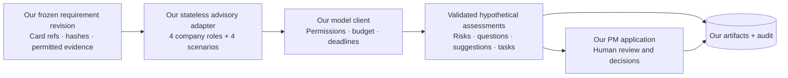

# G60 × Parallax — integration record

**Checked 11 October 2026. Parallax is the main product application**, deployed at https://parallax.dehlwes.net/ and merged into `main` at `469e848`. The G60 workbench is a companion evidence-preparation and evaluation implementation. Both use the shared research contract.

The companion engineering prototype and automated provisional G60 US run are complete. Human labels, extraction-quality evaluation, evidence acceptance, persona grounding and PM decisions remain pending in that companion workspace. The deployed Parallax overview separately shows requirements, councils and PM decision history; these are independent product-state histories today. This record describes implemented behavior and the latest upstream source check; the [BMW alignment matrix](BMW_ALIGNMENT.md) tracks final demonstration acceptance.

## Versions and verification

| Component | Inspected revision | Verification in this check |
| :--- | :--- | :--- |
| Parallax backend | [`5e378dd`](https://github.com/eklavyagoyal/ehl-finale-munich-submission/tree/5e378dd/backend), `origin/feat/backend` | Freshly fetched; inspected source and changes since `428d825`. All **9 pure unit tests pass** in an isolated copy, with mock model configuration. |
| Parallax dashboard | [`edad20f`](https://github.com/eklavyagoyal/ehl-finale-munich-submission/tree/edad20f/frontend), `origin/dashboard` | Freshly fetched; inspected routes, components and changes since `e0718da`. No fresh frontend build or deployment test in this check. |
| Our advisory adapter | `scripts/g60_parallax.py` (companion checkout), `parallax-adapter-v1` | Company/market prompt lineage adapted from backend `428d825`; our schemas, model client, store and revision rules define the execution contract. |
| G60 companion core | Local `feat/g60-pipeline` implementation | The completed provisional run and engineering verification are recorded in the [alignment matrix](BMW_ALIGNMENT.md). These results are distinct from upstream tests. |

The fetched `main` commit `469e848` contains backend and frontend trees identical to the revisions above. The deployed overview loaded successfully during this check. Fetching updated remote-tracking refs. The existing Parallax review worktrees remain at their earlier revisions; the latest backend tests ran in a separate ignored snapshot. No Parallax working files, branches, databases or deployments were changed, and nothing was pushed. The unit tests do not exercise its Postgres/API flow, live models, TinyTroupe or dashboard.

## Current Parallax capabilities

The current upstream implementation adds useful ways to understand the decision process:

| Area | Latest upstream implementation |
| :--- | :--- |
| **Vehicle context** | Vehicle-specific dashboard pages and vehicle/market-scoped processing. Brand-wide app feedback is distinguished from model demand. |
| **Evidence interpretation** | Review triage, BMW vocabulary labelling, calibration support and source/author/text signal weights. |
| **Council deliberation** | Explicit department positions and counterarguments; customer scenarios allocate a constrained budget between requirements and keeping the price. Market-scoped persona execution is supported. |
| **Process visibility** | A visual pipeline, run history, replay and visible weighting controls. |
| **Call inspection** | An individual-call API and dashboard panel expose the stored prompt, answer, summary, metadata and citations, with an explicit note when an earlier answer was not retained. |
| **Decision navigation** | Vehicle-specific decisions, evidence, councils, simulation and timeline views. |

Source entry points: [company roles](https://github.com/eklavyagoyal/ehl-finale-munich-submission/blob/5e378dd/backend/parallax/agents/company_twin.py), [market personas](https://github.com/eklavyagoyal/ehl-finale-munich-submission/blob/5e378dd/backend/parallax/agents/market_twin.py), [simulation and call routes](https://github.com/eklavyagoyal/ehl-finale-munich-submission/blob/5e378dd/backend/parallax/api/routers/simulations.py), and [dashboard components](https://github.com/eklavyagoyal/ehl-finale-munich-submission/tree/edad20f/frontend/src/components).

These are upstream capabilities. Our current adapter does not automatically inherit them, and our local PM application does not embed the new dashboard. Keeping this distinction explicit avoids presenting two independent state machines as one integrated product.

## Two complementary implementations

Parallax owns the primary cockpit, application API, database, council workflow, scoring, product decisions and application audit. The G60 companion owns its local research artifacts, extraction evaluation and experimental runs. The shared batch/context-packet import is implemented in Parallax. A richer import of G60 cards, frozen requirement revisions, review metadata and evaluation results has not been implemented.

For the joined product, Parallax should remain the place where the PM decides, with explicit provenance back to companion artifacts. Do not present the two current audit logs as one synchronized history. Parallax incorporates labelled simulated/assumed score ranges; the companion excludes jury opinions from its evidence score. Those semantics must survive any future handoff.

## Implemented companion advisory boundary

The diagram below describes the already-built **G60 experiment path**, not the deployed Parallax orchestration. Its stateless adapter adapts Parallax’s earlier prompts while retaining the companion’s execution controls.



The adapter adapts the pure company-role and market-persona prompting approach. It does not import Parallax's ORM, SQL-coupled model client, orchestration, scoring or decision store. It does not call the full `/api/simulations` lifecycle. All live calls pass through our existing model client and its allowlist, permissions and spend controls.

The four internal perspectives are design/UX, engineering questions, US market/sales fit and PM/evidence. The four external perspectives are provisional scenario personas until their attributes receive human grounding. Same-model perspectives are correlated synthetic critique; they do not establish independent expertise, customer prevalence or purchase forecasts.

## Companion adapter contract

Entry point:

```python
run_parallax(
    workspace,
    requirement_id,
    client,
    batch_root,
    challenge=None,
    request_id=None,
)
```

Returns `run_id`, `request_id`, `status`, `manifest`, `assessments` and `failures`.

| Boundary | Contract |
| :--- | :--- |
| **Frozen input** | Core-minted request ID; requirement ID/revision/hash; card IDs/revisions/hashes; prompt/schema hashes; role/persona versions; permission event IDs; model/provider/destination identity. |
| **Permitted view** | Bounded requirement/card content and request-local citation handles. Responses may cite only the evidence visible in that request. |
| **Structured response** | `hypothetical: true`, matching request/revision, observations, risks, questions, suggested edits and validation tasks. Evidence-based statements must use valid visible citations. |
| **Persistence** | Validated assessments, suggestions and tasks enter our event log with hash-bound manifests. Evidence, counts, scores, gates and decision status remain unchanged. |
| **Revision protection** | Changed requirement revisions, changed card hashes and revoked permission are refused before storing results. Human edits create a new requirement revision and reset approval/scoring. |
| **Idempotency and recovery** | Identical delivery rechecks permissions and avoids duplicate assessments. Partial runs retain successful perspectives and expose failures; resume targets the missing perspectives. |
| **Failure handling** | Invalid schema/citations receive bounded repair or explicit failure. Missing perspectives are not filled with invented neutral opinions. |

The adapter is advisory. A PM can inspect suggestions, edit a requirement, request validation or challenge a revision through our core. Any adopted change carries a real actor and reason in the companion audit.

## What remains for the demonstration

1. Label and adjudicate the real pilot, measure extraction quality and record actual human review.
2. Review needs, evidence cards, contextual mappings and scenario attributes; retain unsupported values as unknown.
3. Exercise an actual PM inspection, edit/challenge and decision on the current requirement revision.
4. Use the exported blinded A/B packet to evaluate whether human-adopted jury suggestions improve actionability or uncover useful missing information.

The next integration task is an explicit artifact handoff into Parallax: source/claim identity, reviewed card references, hashes, coverage and evaluation status. Keep the existing cockpit and product decision flow primary; use the companion to make their evidence basis reproducible. A unified cross-system decision history and rich-card synchronization are future work. The [G60 runbook](README.md) and [BMW checklist](BMW_ALIGNMENT.md) describe the companion’s remaining human evaluation.
